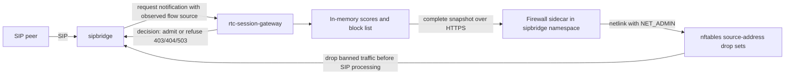

# SIP Firewall Plan

Status: implemented for the native sipbridge integration. The
[SIP firewall guide](../guide/sip-firewall.md) describes configuration, APIs,
transport and recovery. This page records the design rationale and what each
validation covers.

## Recommendation

Let rtc-session-gateway own SIP abuse classification, scoring, allowlisting and the
authoritative block list in memory. Run a separate, small Linux firewall sidecar
in the network namespace it shares with sipbridge to apply that list through
nftables. Keep `NET_ADMIN` and native firewall dependencies out of the gateway
process and image. Use complete snapshots and periodic reconciliation; no Redis or
database is needed. Restarting the gateway resets its learned state.

## Detection and admission

sipbridge presents every fresh request to the gateway and waits for one decision.
The notification carries the flow's `sourceIp`, `sourcePort` and `transport`, taken
from the network, never from SIP headers, `Contact`, caller numbers or forwarded
headers. The gateway runs its source policy there, before any owner webhook,
media allocation or call state:

| Condition                                                     | Result                                                                               |
| ------------------------------------------------------------- | ------------------------------------------------------------------------------------ |
| Gateway draining, not connected or not admitting              | 503, never scored                                                                    |
| Source banned (enforce mode), any method                      | 403, no score, ban not extended                                                      |
| INVITE for an unknown host or without a route                 | 404 and one observation (weight 1; NANP-plausible 0.25; `00`/`011`/`000` prefixes 2) |
| Application rejection, drain, capacity, webhook failure       | Not scored                                                                           |
| Ack, BYE, CANCEL, re-INVITE, other established-dialog traffic | Not scored                                                                           |
| Unknown or invalid `Replaces`                                 | Not scored by default (`SIP_FIREWALL_OBSERVE_UNKNOWN_REPLACES`)                      |

Each fresh request sipbridge presents is one observation (it absorbs same-branch
retransmissions); no-route misses are not scored while no owner is connected or within
`SIP_FIREWALL_ROUTE_GRACE_MS` of an owner disconnect. The in-handler route checks remain as an unscored fallback.
sipbridge answers OPTIONS itself, so the policy sees only requests sipbridge
presents. Scores decay with a ten-minute half-life, ban at 10, and ban for 15
minutes, 1, 6 then 24 hours. This detects repeated invalid attempts; a flood aimed
at valid routes needs a separate rate or capacity policy. The gateway has no
inbound registrar or digest verifier, so there is no authentication-failure
detector.

The kernel ban drops all traffic from the source to the namespace, including
signaling for active calls from that address. Allowlist trusted carriers. Host
networking needs a separately qualified backend that scopes drops to the SIP
listeners and is unsupported.

## Deployment constraints

- The sidecar is a separate AGPL-3.0-only image. `nftables-napi` must never enter
  the gateway's dependencies or production image.
- Share a dedicated network namespace with sipbridge only (pod or Compose
  `network_mode: service:sipbridge`); `NET_ADMIN` on the sidecar container only.
- `FIREWALL_PROTECTED_CIDRS` must include the gateway and any probe, kubelet and
  node ranges. Whole-namespace drops would otherwise cut off the control session,
  the receiver or health checks. Allowlists apply at both the gateway and sidecar.
- The source IP must survive to the pod (for Kubernetes, `externalTrafficPolicy:
Local` or an equivalent that preserves it). SNAT makes every caller one address.
- Exactly one gateway owns each sidecar. A new instance replaces the previous
  snapshot once its start time is later. Control-session loss ends all calls on
  Memory sipbridge by design, so the gateway restarts with empty learned state.

## State and snapshots

One `SipFirewall` instance performs synchronous state transitions without network
I/O between the allowlist check and updating scores or bans. Automatic and manual
candidates stay separate; the effective union uses the longer expiry and excludes
any target overlapping the allowlist. Automatic bans use exact IPv4 addresses and
IPv6 /64s; manual bans may use CIDRs. Capacity is bounded (100,000 records, 10,000
bans) and never evicts a live ban. `off` publishes an empty list, `shadow` scores
without banning, `enforce` bans. Manual bans outside enforce mode are rejected.

Snapshots are full, versioned and finite (`schemaVersion`, `instanceId`,
`revision`, `generatedAt`, `allowlist`, `blocks[{target,expiresAt}]`), at most 2 MiB,
published on change and every five seconds with a one-second deadline. Failure never
blocks SIP processing. The sidecar validates, diffs a serialized mirror, recreates
changed-timeout entries, reconciles every 30 seconds, and on process start resets
only its owned tables and reapplies. Kernel TTLs never renew.

## Failure behavior

| Condition                             | Behavior                                                                                                |
| ------------------------------------- | ------------------------------------------------------------------------------------------------------- |
| Publisher unavailable or bad snapshot | Last valid kernel state stays; finite bans expire at their original deadlines.                          |
| Gateway restart                       | Scores, tiers and runtime bans reset; the new instance's first snapshot replaces the old one.           |
| Sidecar restart                       | sipbridge stays up; owned tables are rebuilt from the next snapshot; briefly fails open.                |
| Whole sipbridge namespace restart     | Empty kernel state until the next snapshot; the gateway's admission check still refuses banned sources. |
| Kernel apply failure                  | Successful changes stay, degradation reported, convergence retried; no readiness dependency.            |
| Capacity reached                      | Live bans kept; new observations skipped and counted.                                                   |

## Validation evidence

- `yarn test`: scoring, decay, tiers, allowlist overlap, capacity, shadow/off,
  snapshot validation and authentication, reconciler recovery, operator API.
- Native tests (`test/sipbridge-native.test.ts`, real sipbridge): banned source
  refused with 403 for INVITE and another fresh method without owner calls or call
  state; unrouted INVITE scored once per transaction and the scanner then banned.
  The tests send from a non-loopback local address because loopback is never scored.
- `yarn e2e:firewall`: Compose with the pinned sipbridge image, the gateway over
  mTLS, the sidecar in sipbridge's namespace, an attacker and an allowlisted
  carrier. Covers IPv4 UDP and TCP scans, carrier allowlisting, kernel drops,
  adjacent-range removal, manual and unblock, changed timeouts, kernel expiry with
  the sidecar stopped, sidecar restart with stale entries, gateway owner
  replacement, and sipbridge+sidecar recreation. IPv6 attacker traffic uses a
  separate /64 reaching sipbridge's `[::]:5060` listener, because an automatic IPv6
  ban covers its /64 and that range must contain neither the gateway nor a carrier.
  It requires Docker with nftables available to containers.

Production shadow-mode qualification and carrier allowlist selection remain
deployment work; nothing here activates enforcement in a live environment.
