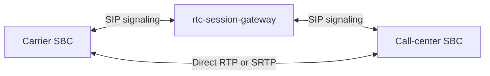

# External SIP Handoff and Referral Return

Status: implemented on the native sipbridge signaling layer. Production
carrier and call-center qualification is still required before deployment.

## Intended Behavior

Transfer an established call to an external SIP URI while keeping the gateway in
the signaling path. Stop recording before exposing external media to the caller,
release the call's rtpbridge resources, and end the application's handling
episode. The gateway retains both SIP dialogs and handles their remaining
signaling without depending on the application control connection or rtpbridge.

Preserve a stable logical call identity across handoff and any return that can be
correlated through an existing SIP dialog or an authorized `Replaces` match. A
referred INVITE without that evidence follows ordinary inbound routing, even if
it may represent a call previously handled by the application.



The gateway keeps relaying SDP inside SIP messages. It no longer creates audio
endpoints or advertises rtpbridge media addresses after handoff. Direct media
requires compatible codecs, media security, and reachable addresses at both
remote endpoints. SIP transport security and media security are separate
requirements.

## Implementation

The public command is [`sip.transfer`](../reference/control-protocol.md#external-sip-handoff),
with an HTTP equivalent at `POST /calls/:callId/transfer`. The canonical contract
types live in `src/sip-handoff-contract.ts`. A consumer that talks to the transfer
API can export its own copy of that file:

```bash
node scripts/export-sip-contract.mjs /path/to/consumer/rtc-sip-handoff.ts
```

sipbridge owns every SIP transaction, retransmission, ACK/2xx timer, same-dialog
glare (`491`) and unacknowledged-2xx teardown. The gateway supplies only the
application decisions through these native primitives:

| Need | Native primitive |
| --- | --- |
| Destination offer without SDP | `openUac` with an empty body; the 2xx offer arrives with the ANSWERED event and the ACK waits for the application. |
| Destination ACK answer | `DialogRequest` `ACK` with the SDP answer. |
| Re-INVITE without SDP, either direction | `DialogRequest` `INVITE` with no body, returning the 2xx offer, then `ACK` with the answer. |
| Answer carried in a peer's ACK | `sip.reinvite-ack.v1`: an accepted ACK for a peer re-INVITE is delivered as ACKNOWLEDGED with the full message and `inviteCseq`. The gateway requires this capability. |
| In-dialog REFER, UPDATE, NOTIFY | Presented as dialog requests; REFER and NOTIFY use `DialogRequest`. |

The initial handoff requires a final late offer. Provisional responses from the
destination, including early SDP, are observed for logging and never relayed or
used as a reason to cancel. The gateway preserves media ordering and SDP origin
continuity, and bounds the time between receiving the destination's offer and
completing its ACK to ten seconds. Both remote peers must support compatible and
directly reachable RTP/SRTP.

This deployment has one gateway and one sipbridge. REFER returns and `Replaces`
matches are resolved against the dialogs held by this gateway only; there is no
distributed live-dialog directory and no transparent failover of external
conversations if the gateway or sipbridge stops.

### Handoff invariants

The implementation in `src/sip-gateway.ts` is organized around these rules.

1. Ownership transitions (`application`, `transferring`, `handed-off`,
   `returning`) are synchronous: no `await` separates the check from the change.
2. At most one cross-leg SDP operation runs per call (`modifyingPairs`): transfer,
   return, relay, replacement and application re-INVITE exclude each other and a
   conflicting request receives `491` or `CONFLICT`.
3. Recording stop is confirmed before any destination SDP reaches the carrier.
4. Detached or replaced legs are ignored by dialog handlers, so a late BYE from a
   retired leg cannot end the live call.
5. A native context with an uncertain command outcome is fenced. The gateway never
   commands it again, not even BYE; the operation reports `SIGNALING_UNKNOWN` and
   sipbridge's native timers clean up.
6. An answered late-offer leg always receives exactly one ACK (the real answer, or
   a rejection of its offer) before any BYE. Timeout and normal paths race for a
   single ACK token.
7. A paired BYE is sent exactly once; removing the call from the registry is the
   token that authorizes it.

Transfers run inside the gateway lifecycle tracker and are rejected while the
gateway drains. Handed-off calls keep drain open and are ended (both legs) at the
drain deadline.

## Handoff Flow

1. Keep existing caller audio or hold music while dialing the destination with an
   INVITE without SDP.
2. Receive the destination's SDP offer in its successful final response.
3. Stop every recording on the call's media session and require confirmation.
   Preserve the returned backend/path metadata for archival.
4. Re-INVITE the existing carrier dialog with the destination's offer, keeping the
   carrier dialog's SDP origin/version and media-section order.
5. Validate the carrier's answer (audio accepted, compatible codecs and protocol),
   then ACK the destination with that answer.
6. Commit both dialogs to gateway ownership, release call media and playback, and
   report the handoff timestamp to the application.

Busy, rejected, and unanswered destinations leave the original call working.
Recording-stop failure aborts the handoff. Carrier renegotiation failure
acknowledges the answered destination with a rejection and ends it while the old
media is retained. After a partial media switch the carrier's previous media is
restored; if restoration fails the call is ended rather than reported usable. An
expired ten-second deadline ends the call if the carrier may already have switched.
Caller hangup during setup cancels or tears down all replacement work.

The first version must establish direct media or report failure. It never keeps an
rtpbridge relay to make an incompatible destination appear to meet the
signaling-only contract.

## Relay While Handed Off

Re-INVITE and UPDATE with SDP from either peer are forwarded to the other leg and
the answer is relayed back. A bodyless UPDATE is a per-dialog session refresh and
is answered without relay.

An offerless re-INVITE is relayed in full: the other leg is re-INVITEd without
SDP, its 2xx offer is returned to the requester, and the answer in the requester's
ACK (delivered by `sip.reinvite-ack.v1`, correlated by CSeq) becomes the body of
the other leg's ACK. A peer that refuses the offerless re-INVITE (for example cross-leg glare or `488`)
changes nothing: the requester receives `491` for glare and `488` otherwise and the
call continues. Only after the peer's offer was obtained is a failed relay fatal,
because the rejection ACK disabled that leg's media. Both waits are bounded, and a leg still owed its ACK is always
ACKed (rejecting the relayed offer) before any BYE, whichever path ends the call. If the ACK never arrives, has no SDP
or cannot be relayed, the other leg's offer is rejected in its ACK and the call is
ended, because the two legs no longer agree on media.

## Referral Return and Deduplication

A referral reaches the gateway either as a REFER on the retained call-center
dialog or as a new INVITE generated after a REFER elsewhere.

| Incoming request | Required behavior |
| --- | --- |
| REFER on a known dialog, targeting an application inbound route | Return that logical call locally; avoid originating a SIP call back into the gateway itself. |
| INVITE with an authorized `Replaces` matching a live dialog | Replace the affected dialog under the existing logical call. |
| Referred INVITE without `Replaces` | Create a new logical call and use normal inbound routing. |
| Explicit `Replaces` with no matching dialog | Reject with `481`; never reinterpret it as an unrelated inbound call. |
| Malformed `Replaces` | Reject with `400`. |
| `Replaces` from an address that is neither call peer | Reject with `403`. |

A REFER on an application-owned call is refused with `405`; only a return on a
handed-off call is processed. If the destination's address cannot be resolved when
a `Replaces` arrives the gateway answers `503` with `Retry-After` and does not
score the source; the addresses resolved at transfer commit are used when known.

`Replaces` is matched on the exact Call-ID and both dialog tags (to-tag is the
gateway's tag), and authorized only from the observed source address of one of the
call's two peers. An inbound leg records the source address sipbridge observed.
sipbridge reports no source for an outbound (UAC) leg, so the transfer
destination is authorized by its configured host (the `proxy` if given, otherwise
the `requestUri` host), resolved when the check runs. Malformed and unauthorized
`Replaces` requests are scored by the SIP firewall; an unknown `Replaces` is scored
only when `SIP_FIREWALL_OBSERVE_UNKNOWN_REPLACES=true`.

Caller number, display name, destination DID, `Referred-By`, and Call-ID alone are
insufficient to deduplicate. SIP retransmissions and in-dialog re-INVITEs keep
their transaction/dialog semantics and are not new application calls.

### Returning a Known Dialog

A REFER on a handed-off dialog whose `Refer-To` is an application route is claimed
once (`returning`). The gateway asks the application whether it accepts the return
(`sip.invite` with `returning`, `logicalCallId` and `previousSessionId`),
re-anchors the retained carrier dialog to application media with a re-INVITE,
commits one application handling episode, reports progress with NOTIFY and then
ends the old destination leg. The old leg is detached first so a delayed BYE cannot
end the live call. If admission or negotiation fails the external conversation is
left working and the REFER receives a failure NOTIFY. A return needs live
application and media capacity even though a handed-off call does not.

An authorized `Replaces` INVITE for an application-owned call renegotiates the
application's existing episode over the replacement dialog and ends the old one. For
a handed-off call it starts a returned episode and ends both retained dialogs.

### Application History

Handoff ends the application handling episode, not the logical identity. A return
reuses an active episode if present, otherwise the application creates a linked
episode with its own timestamps, leg, and recording identifiers. The finalized
episode and archive are preserved; the external interval is unrecorded.

## Known Limitations

- In-dialog requests that arrive on a different transport flow than the dialog's
  (for example a REFER on a new TCP connection) are refused with `403`. There is no
  flow adoption, so a call-center SBC must send in-dialog requests on the
  established connection.
- A native in-dialog NOTIFY or UPDATE we send waits for the peer's response; a
  peer that never answers can fence that context after the native client timeout.
- sipbridge reports no source address for outbound legs; see the `Replaces`
  authorization fallback above.
- On a REFER return the application receives the carrier's last SDP as the offer and
  its answer is sent to the carrier as a new offer. The carrier's answer to that
  re-INVITE is recorded on the call but not delivered to the application, so a
  carrier that changes its media address or keys in that answer is not followed.
  Returning via an offerless carrier re-INVITE would remove the limitation at the
  cost of touching the carrier before the application has accepted.
- A destination that hangs up right after sending the return REFER (a blind
  transfer) is detached without ending the call; if the return then fails the call
  is ended because no external party remains.
- No transparent migration of live external conversations between gateways.

## Acceptance

Deterministic tests (`test/sip-handoff.test.ts`) cover the state machine against a
fake native dialog: duplicate and conflicting transfer IDs, recording ordering,
carrier and destination failures with restoration, the ACK deadline and its race,
offerless relay in both directions and its failure paths, fenced contexts, drain
rejection, paired BYE exactly once, REFER return, `Replaces` matching and
authorization. `test/sipbridge-native.test.ts` runs the late-offer UAC, offerless
re-INVITEs, REFER/NOTIFY, UPDATE and a complete handoff with relay against the
pinned native sipbridge. The Compose E2E (`yarn e2e:compose`) adds sustained
two-way direct RTP and SRTP, owner disconnect and media-backend shutdown after
handoff, hold/resume and offerless relay through the real stack, recording
boundaries, REFER and `Replaces` returns, and cleanup.

- [ ] Qualify actual carrier and call-center late-offer, early-media, codec,
      security, and media reachability behavior before deployment.

## References

- [RFC 3725: SIP third-party call control](https://www.rfc-editor.org/rfc/rfc3725.html).
- [RFC 3264: SDP offer/answer and modification](https://www.rfc-editor.org/rfc/rfc3264.html).
- [RFC 3515: REFER and progress notifications](https://www.rfc-editor.org/rfc/rfc3515.html).
- [RFC 3891: Replaces matching and authorization](https://www.rfc-editor.org/rfc/rfc3891.html).
- [RFC 5589: SIP call transfer flows](https://www.rfc-editor.org/rfc/rfc5589.html).
- [Native SIP implementation](./native-sipbridge-plan.md).
