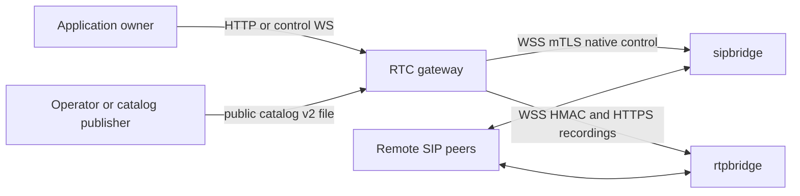

# Cross-Cluster Deployment

RTC connects directly to sipbridge for native SIP control and to rtpbridge for
media control and recording access. Application owners use RTC's HTTP or control
WebSocket API. These are the only runtime integration boundaries; RTC needs no
other backend service, registry client or signaling tunnel.

The deployment writes the catalog file, for example from an operator-managed
config map, a supervisor or an optional discovery publisher. RTC only reads the
file; it never contacts the publisher's registries or uses its credentials. Local
Compose writes the catalog itself and runs with sipbridge and rtpbridge alone.

## Endpoint catalog and identity

Set `RTC_ENDPOINTS_FILE` to an atomically replaced catalog v2. Download the
[JSON Schema](/contracts/endpoint-catalog-v2.schema.json) and
[synthetic example](/contracts/endpoint-catalog-v2.example.json). Each of the
`signaling` and `media` sections requires a 64-hex revision, an ISO `validUntil`
and unique IDs. A document holds at most one signaling endpoint and 128 media
backends in 256 KiB. The gateway checks for replacements every second; write a
complete temporary file and rename it into place.

A signaling entry requires a WSS `/v1/control` URL and `tlsServerName`, and its
`id` must equal the instance ID sipbridge reports in its hello. Mount the
controller identity with `SIPBRIDGE_TLS_CERT_FILE` and `SIPBRIDGE_TLS_KEY_FILE`,
and server trust with `SIPBRIDGE_TLS_CA_FILE`. These files are re-read for each
connection, which verifies the server against `tlsServerName`. Media entries use
root WSS control and optional HTTPS recording URLs, with separate ports/TLS names
if needed, plus `RTPBRIDGE_AUTH_HMAC_SECRET_FILE` and `RTPBRIDGE_TLS_CA_FILE`.
Without `recordings`, the recording URL is derived from the control URL.

A missing, expired or empty catalog never triggers DNS fallback. An invalid or
missing replacement keeps the last accepted sections until their original
expiries. When the signaling section expires, new SIP calls are refused; native
sessions carrying calls stay open, and idle ones close. When the media section
expires, new media sessions are refused; open media clients and recording access
to known backend IDs remain. A call pinned to a backend never moves to another.

## Bootstrap, routing and drain

RTC connects to a fresh signaling entry even while it has `acceptNew=false`, and
reports its own admission to sipbridge from local routes, media and lifecycle.
This lets sipbridge become ready after RTC connects. RTC's `/readyz` turns ready
once that entry has `acceptNew=true` and the session is reconciled, provided
`ROUTES_REQUIRED` and `RTPBRIDGE_REQUIRED` are satisfied when set. Owners can
register routes while RTC is unready.

`SIP_ALLOWED_DOMAINS_JSON` limits new inbound INVITEs to exact Request-URI hosts
before destination-user routing. In-dialog requests follow their native context.
`/routing/status` reports local admission, route count and media catalog status.
Use bearer auth for owner control and HTTP commands. Keep each owner's control
connection, and a route to the original process for HTTP-owned calls, through
drain.

Native contexts are bound to sipbridge's state authority, RTC's process epoch and
the application lease term. Reconnects use a higher connection attempt and never
replay mutations. A sipbridge state-authority change, such as a restart with
memory state, ends the old contexts. Unknown outcomes return `SIGNALING_UNKNOWN`
and must not be replayed; an unavailable session returns `SIGNALING_UNAVAILABLE`.
Drain refuses new work and keeps retained native and media sessions until the
configured deadline. See [operations](./operations.md).

## Explicit TURN URLs

Set `COTURN_URLS_JSON` for deployment-wide ICE URLs or `turn.urls` for a backend
override. The existing shared `COTURN_AUTH_SECRET` and expiring REST credentials
apply to TURN URLs; STUN URLs need no secret. URLs may use `stun:`, `turn:` or
`turns:` and must name reachable endpoints with valid certificates where TLS is
used. The gateway does not invent a TLS hostname. Without explicit URLs, a
configured secret retains cohosted STUN and UDP/TCP TURN using the advertised IPv4
media address; this fallback does not advertise TLS TURN.

The gateway owns protocol behavior, admission, affinity and draining. The
deployment owns certificates, firewall rules, routable endpoints, DNS, proxies and
catalog publication.

## Platform acceptance

Local Compose tests exercise real sipbridge and rtpbridge with synthetic
credentials on one Docker network. They do not qualify a cluster network or a
production rollout. Before activating a deployment, validate in staging: endpoint
routing, the delivered client and server identities, catalog expiry, owner routes,
SIP calls, media, recordings and long-call drain. Playback origins must be
reachable from rtpbridge and admitted by its download policy, and media/TURN paths
must work from real remote peers.
