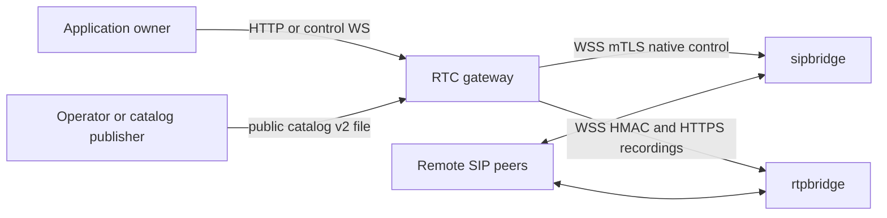

# Cross-Cluster Deployment

RTC connects directly to sipbridge for native SIP control and to rtpbridge for
media control and recording access. Application owners use RTC's HTTP or control
WebSocket API. These are the runtime integration boundaries; no Zynotalk backend,
private SDK, registry client or signaling tunnel is required.

A deployment may use a discovery sidecar to create the catalog. It may also
supply the file through its own supervisor or configuration process. RTC never
contacts that publisher's registries or requires its implementation. Local Compose
creates the catalog itself and runs with sipbridge and rtpbridge alone.

## Endpoint catalog and identity

Set `RTC_ENDPOINTS_FILE` to an atomically replaced public catalog v2. Download the
[JSON Schema](/contracts/endpoint-catalog-v2.schema.json) and
[synthetic example](/contracts/endpoint-catalog-v2.example.json). Both signaling
and media sections require a 64-hex revision, ISO expiry and unique IDs. At most
one signaling endpoint and 128 media backends fit in a 256 KiB document.

Signaling requires WSS `/v1/control` and `tlsServerName`. Mount the controller
identity with `SIPBRIDGE_TLS_CERT_FILE`, `SIPBRIDGE_TLS_KEY_FILE` and server trust
with `SIPBRIDGE_TLS_CA_FILE`. This identity is separate from discovery reader
credentials. Every reconnect reloads identity/trust files and verifies SNI.
Media uses root WSS and HTTPS recording URLs, separate ports/TLS names if needed,
and the existing `RTPBRIDGE_AUTH_HMAC_SECRET_FILE`/CA configuration.

Missing, expired or empty catalog capacity cannot trigger DNS fallback. An invalid
replacement retains the last accepted sections until their original independent
expiries. An expired signaling section withdraws new SIP while retaining native
contexts. Expired media withdraws fresh sessions while retaining live clients
and known recording identities. Call/backend affinity never silently migrates.
`RTPBRIDGE_HOST` remains an explicit media-only alternative when no catalog is set.

## Bootstrap, routing and drain

Connect to known fresh signaling even with `acceptNew=false`. RTC publishes native
status from local routes/media/lifecycle independently of core admission. Owners
can register routes while RTC is unready; readiness becomes available after local
admission and fresh native/media capacity agree. `ROUTES_REQUIRED=true` and
`RTPBRIDGE_REQUIRED=true` enforce those admission gates.

`SIP_ALLOWED_DOMAINS_JSON` limits new inbound INVITEs to exact Request-URI hosts
before destination-user routing. Existing native dialogs retain their authority.
There are no application tags or reverse route callbacks. `/routing/status`
exposes local admission/route/media status. Use bearer auth for owner control and
HTTP commands. Preserve each owner's connection and HTTP command affinity to the
original RTC process throughout drain.

Native contexts are tied to state authority, application epoch and lease term.
Reconnects use a higher connection attempt; they never replay mutations. Memory
core restart fences old contexts. Unknown outcomes are `SIGNALING_UNKNOWN`,
which must not be replayed; unavailable sessions are `SIGNALING_UNAVAILABLE`.
Drain withdraws new work and preserves retained native/media sessions through
the configured deadline. See [operations](./operations.md).

## Explicit TURN URLs

Set `COTURN_URLS_JSON` for deployment-wide ICE URLs or `turn.urls` for a backend
override. The existing shared `COTURN_AUTH_SECRET` and expiring REST credentials
apply to TURN URLs; STUN URLs need no secret. URLs may use `stun:`, `turn:` or
`turns:` and must name reachable endpoints with valid certificates where TLS is
used. The gateway does not invent a TLS hostname. Without explicit URLs, a
configured secret retains cohosted STUN and UDP/TCP TURN using the advertised IPv4
media address; this fallback does not advertise TLS TURN.

The gateway owns protocol behavior, admission, affinity and draining. The platform
owns certificates, firewall rules, routable endpoints, DNS, proxy deployment and
translation of its private discovery contracts.

## Platform acceptance

Validate actual endpoint routing, delivered client/server identities, registry
expiry, owner routes, SIP calls, media, recordings and long-call drain in staging
before activation elsewhere. Playback origins must be edge-reachable and admitted
by rtpbridge policy; media/TURN paths must work from actual remote peers. Local
Compose tests exercise real native and media services with synthetic credentials;
they do not qualify cluster networking or production rollout.
